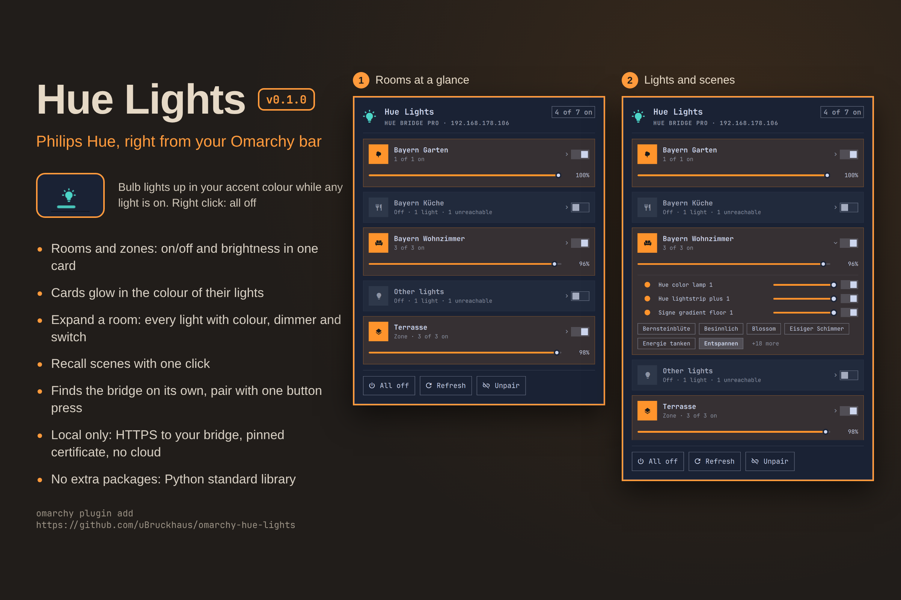

# Hue Lights

Control your Philips Hue lights from the Omarchy bar. Switch rooms, zones and single lights on and off, set brightness and recall scenes, straight over your local Hue bridge. No cloud and no Philips account are involved.



- **Bar icon:** a lit bulb in your theme's accent colour while any light is on, a dim bulb when all are off. Left click opens the panel; right click switches every light off. The tooltip lists your rooms with their brightness.
- **Room cards:** one card per room and zone, with a room icon, "2 of 3 on" status and an on/off switch. Rooms that are on are tinted in the colour of their lights and show a brightness slider.
- **Single lights and scenes:** click a room to expand it: every light with its colour, a brightness slider and a switch, then the room's scenes (the active one is highlighted).
- **Unreachable lights** (for example switched off at the wall) are marked.

## Install

Requires Omarchy's plugin-capable Quickshell, `python3` (standard library only, no extra packages) and `avahi-browse` (Avahi, installed on Omarchy) for finding the bridge. No setup script is needed, and the plugin never asks for root or administrator rights.

```sh
omarchy plugin add https://github.com/uBruckhaus/omarchy-hue-lights
omarchy plugin enable ubruckhaus.hue-lights
```

## Pairing

1. Open the panel. Hue bridges on your network are found automatically via mDNS, or enter the bridge IP by hand.
2. Click **Pair**, then press the round link button on top of the bridge within 30 seconds.

If the bridge later gets a new IP address, the plugin finds it again by its bridge ID.

## How it works

A helper (`scripts/hue-lights.py`) runs while the widget is loaded. The bar widget sends it JSON commands over stdin (on/off, brightness, scene, pair, unpair); it answers with JSON snapshots on stdout, every 2 s while the panel is open and every 20 s while it is closed.

- **Local only:** the helper talks to the bridge's local CLIP v2 API over HTTPS on your LAN. It makes no other network requests.
- **Pinned certificate:** the bridge uses a self-signed Philips certificate. When pairing, the plugin checks that the certificate name equals the bridge ID the bridge reports, and stores the certificate's SHA-256 fingerprint. Every later connection must present exactly that certificate, otherwise nothing is sent.
- **Bounded requests:** every request has one overall deadline (connect, TLS, headers and body) and a 4 MiB reply limit. `avahi-browse` runs as a fixed argument list with bounded output and a timeout.
- **Validated commands:** light, group and scene IDs must be Hue UUIDs; the bridge address must be a private IPv4 address. Brightness is clamped to 1–100 %, and commands are rate limited as Philips recommends.
- **Sanitized text:** room, light, scene and bridge names are stripped of `<`, `>`, `&` and control characters, and every QML `Text` renders as plain text.
- **App key:** stored in `~/.config/omarchy/hue-lights/config.json` (directory `0700`, file `0600`, written atomically through a unique temp file). It never leaves the helper process.

## Update or remove

```sh
omarchy plugin update ubruckhaus.hue-lights
```

```sh
omarchy plugin disable ubruckhaus.hue-lights
omarchy plugin remove ubruckhaus.hue-lights
```

The plugin creates no services. The only file outside its folder is `~/.config/omarchy/hue-lights/config.json`. **Unpair** in the panel deletes it (or delete the directory yourself). To revoke the key on the bridge as well, remove the "omarchy_hue_lights" app in the Hue app under Settings > Apps.

## Development

```sh
python3 -m unittest discover -s tests
```

The tests include hostile bridge replies (silent server, dripping headers, endless body, huge `Content-Length`, wrong certificate), symlinked or permissive config files and markup in names.

## License

MIT
