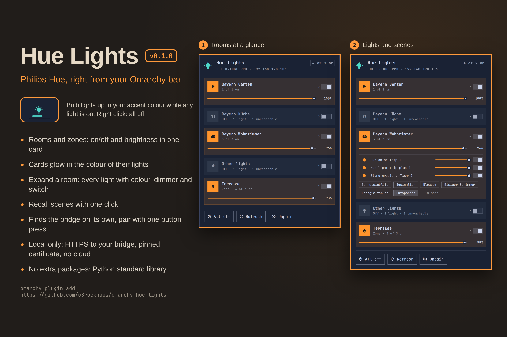

# Hue Lights

Control your Philips Hue lights from the Omarchy bar. Switch rooms, zones and single lights on and off, set brightness and recall scenes, straight over your local Hue bridge. No cloud and no Philips account are involved.



- **Bar icon:** a lit bulb in your theme's green while any light is on, a dim bulb when all are off. Left click opens the panel; right click switches every light off. The tooltip lists your rooms with their brightness.
- **Room cards:** one card per room and zone, with a room icon, "2 of 3 on" status and an on/off switch. Rooms that are on are tinted in the colour of their lights and show a brightness slider.
- **Single lights and scenes:** click a room to expand it: every light with its colour, a brightness slider and a switch, then the room's scenes (the active one is highlighted).
- **Unreachable lights** (for example switched off at the wall) are marked.

## Languages and settings

The interface is built in in eight languages: English, German (Deutsch), French (Français), Spanish (Español), Italian (Italiano), Portuguese (Português), Dutch (Nederlands) and Polish (Polski). It follows the system language (`LC_ALL`, `LC_MESSAGES`, `LANG`) and falls back to English. To pick another one, open the **gear (⚙)** at the top right of the panel → **Language**. The translations ship with the plugin: nothing is downloaded or generated, and the plugin makes no extra requests for them. The choice is stored in the widget's own entry in `~/.config/omarchy/shell.json` (`"language"`); **System (…)** removes it again.

The settings page opens from the gear and closes with **← Back**, Backspace or Esc. It also shows the paired bridge and **Unpair**, which used to be in the main panel. Besides **Language** it has:

- **Corners:** *Like windows (… px)* (the default) follows Hyprland's window rounding (`decoration:rounding`, as the shell reads it), *Slightly rounded (6 px)*, *Rounded (12 px)* or *Square*. It rounds the panel's room cards, buttons, scene buttons, drop-downs, the IP field, room and light badges, colour dots and switches (cards and pop-ups at the full radius, buttons, drop-downs and fields at most 8 px, tracks and swatches at most 4 px; switches, badges and dots round, or square in *Square*). The panel's outer frame, its tool tips, the status pill in its header and the shell's sliders are drawn by the shell and keep the shell's rounding. Stored as `"corners"` in the widget's entry in `~/.config/omarchy/shell.json`; *Like windows* removes it again.
- **F12 saves a screenshot** (on by default; stored as `"screenshotKey": false` when switched off, see below).

### F12: a screenshot of the panel, with a note

While the panel is open, **F12** (without Ctrl, Shift, Alt or Super) saves a picture of the panel, for telling what is wrong with it, as in the author's GTK apps:

- **Only on F12.** Nothing is captured at any other time, and only the panel itself: Qt draws the panel's own content into the picture (`grabToImage`). No screen capture tool runs, nothing else on the screen is in it, and nothing is uploaded or sent anywhere.
- **Where:** `~/Pictures/Hue Lights/hue-lights-<date>-<time>.png` (the pictures folder from `~/.config/user-dirs.dirs` when it is set there). A panel then names the file and asks **What is wrong? (optional)**; **Enter** or **Done** saves the text next to the picture as a `.txt` with the same name (at most 4000 characters; no text, no file), **Esc** skips it, and closing the panel keeps what was typed.
- **Private files:** the folder is made `0700` when missing and only used when it is a real folder (not a link) of yours that no one else can write to; pictures and notes are new `0600` files, never written through a link or over an existing file (`-2`, `-3` … are added instead), and a picture that cannot be written completely is removed again.
- **How:** the panel first writes the picture into its own folder `$XDG_RUNTIME_DIR/ubruckhaus.hue-lights-shot/` (`0700`, in memory; used only when `$XDG_RUNTIME_DIR` is a real folder of yours that no one else can write to, and every folder above it one that no other account can change, since Qt writes the picture there by name; a picture left there by a save that never ran is removed when the panel loads, or before the next screenshot, once it is two minutes old). `shot_save.py` (Python standard library) is then started with a fixed argument list, never through a shell: `cleanup <plugin id>` (when the panel loads), `prepare <plugin id>`, `save <picture> "Hue Lights"` (checks that the picture is a regular file of yours in that folder, at most 32 MiB and a PNG, copies it as above and removes it), and `note <picture> "Hue Lights"` with the note on its standard input. Each call answers with one line of JSON. A new F12 waits until the note before it is written; switching F12 off stops new screenshots, not one already being saved.
- **Off:** switch **F12 saves a screenshot** off on the settings page; F12 then does nothing in this panel.

The **ⓘ** button beside the gear opens an **Information** page with a card for each of the author's other plugins in the Omarchy Plugin Marketplace, with a short description in the panel's language. A click on a card opens that plugin's marketplace page in the browser (a fixed `https://plugins.omarchy.org/plugin.html?id=…` address). The list comes from the marketplace's catalog, so newly published plugins of the author appear without a Hue Lights update; a plugin this version does not know yet shows the first sentence of its marketplace description, in English (see *How it works*). **← Back**, Backspace or Esc returns.

## Install

Requires Omarchy's plugin-capable Quickshell, `python3` (standard library only, no extra packages) and `avahi-browse` (Avahi, installed on Omarchy) for finding the bridge. No setup script is needed, and the plugin never asks for root or administrator rights.

```sh
omarchy plugin add https://github.com/uBruckhaus/omarchy-hue-lights
omarchy plugin enable ubruckhaus.hue-lights
```

## Pairing

1. Open the panel. Hue bridges on your network are found automatically via mDNS, or enter the bridge IP by hand.
2. Click **Pair**, then press the round link button on top of the bridge within 30 seconds.

If the bridge later gets a new IP address, the plugin finds it again by its bridge ID.

## How it works

A helper (`scripts/hue-lights.py`) runs while the widget is loaded. The bar widget sends it JSON commands over stdin (on/off, brightness, scene, pair, unpair); it answers with JSON snapshots on stdout, every 2 s while the panel is open and every 20 s while it is closed.

- **Local only:** the helper talks to the bridge's local CLIP v2 API over HTTPS on your LAN. It makes no other network requests; the Information page's plugin list is read separately (below).
- **Pinned certificate:** the bridge uses a self-signed Philips certificate. When pairing, the plugin checks that the certificate name equals the bridge ID the bridge reports, and stores the certificate's SHA-256 fingerprint. Every later connection must present exactly that certificate, otherwise nothing is sent.
- **Bounded requests:** every request has one overall deadline (connect, TLS, headers and body) and a 4 MiB reply limit. `avahi-browse` runs as a fixed argument list with bounded output and a timeout; when util-linux `setpriv` is installed (it is on Omarchy) it is started through `setpriv --pdeathsig KILL --`, so it ends with the helper even if the helper is killed, and the helper ends it on exit or SIGTERM as well.
- **Validated commands:** light, group and scene IDs must be Hue UUIDs; the bridge address must be a private IPv4 address. Brightness is clamped to 1–100 %, and commands are rate limited as Philips recommends.
- **Sanitized text:** room, light, scene and bridge names are stripped of `<`, `>`, `&` and control characters, and every QML `Text` renders as plain text.
- **Information page (ⓘ):** the only request outside your computer and LAN. Started only when the page is shown (a request in progress finishes even if you leave the page), `plugin_catalog.py` reads the marketplace's catalog `https://raw.githubusercontent.com/omacom/omarchy-plugin-marketplace/main/site/catalog.json` with `curl --proto =https --max-redirs 0` (at most 40 MiB and 40 s, and with the last `ETag`, so an unchanged catalog is not downloaded again; a list cached before this version, when only `github.com/ubruckhaus` counted, is read once more in full without it), at most once an hour per panel, failed attempts included (kept on disk, and by the panel itself while the shell runs; two panels opened in the same moment may each ask once). Only the author's own entries (repositories under `github.com/ubruckhaus` or `github.com/maprisma`, at most 60) are kept, as id, name, version, description text and the verified flag, with the time of the last check and the `ETag`, in `~/.cache/ubruckhaus.hue-lights/plugin-catalog.json` (the folder must be yours, not a link and closed to others — it is made `0700` if missing, otherwise nothing is read or written; file `0600`, written atomically inside that folder; read back only as a regular file of yours, at most 1 MiB). No Hue credentials, bridge information or other local data are sent; GitHub sees the usual request details (your public IP address, the fixed user agent and the `ETag`). Offline, the cached list or the built-in one is shown.
- **App key:** stored in `~/.config/omarchy/hue-lights/config.json` (directory `0700`, file `0600`, written atomically through a unique temp file). It never leaves the helper process.

## Update or remove

```sh
omarchy plugin update ubruckhaus.hue-lights
```

```sh
omarchy plugin disable ubruckhaus.hue-lights
omarchy plugin remove ubruckhaus.hue-lights
```

The plugin creates no services. Outside its folder it keeps `~/.config/omarchy/hue-lights/config.json` and the Information page's cache `~/.cache/ubruckhaus.hue-lights/` (delete that folder too if you like; it is only a cache). Screenshots you took with F12 stay in `~/Pictures/Hue Lights/` until you delete them. **Unpair** (gear ⚙ → Bridge) deletes it (or delete the directory yourself). To revoke the key on the bridge as well, remove the "omarchy_hue_lights" app in the Hue app under Settings > Apps.

## Development

```sh
python3 -m unittest discover -s tests
```

`PanelShot.qml`, `shot_save.py` (with `tests/test_shot_save.py`), `corners.js`, `KeyTextField.qml`, `CompactDropdown.qml`, `MorePlugins.qml` and the shared texts in `I18n.js` come from the author's shared plugin kit and are the same in his other panels.

The tests include hostile bridge replies (silent server, dripping headers, endless body, huge `Content-Length`, wrong certificate), symlinked or permissive config files and markup in names.

## License

MIT
